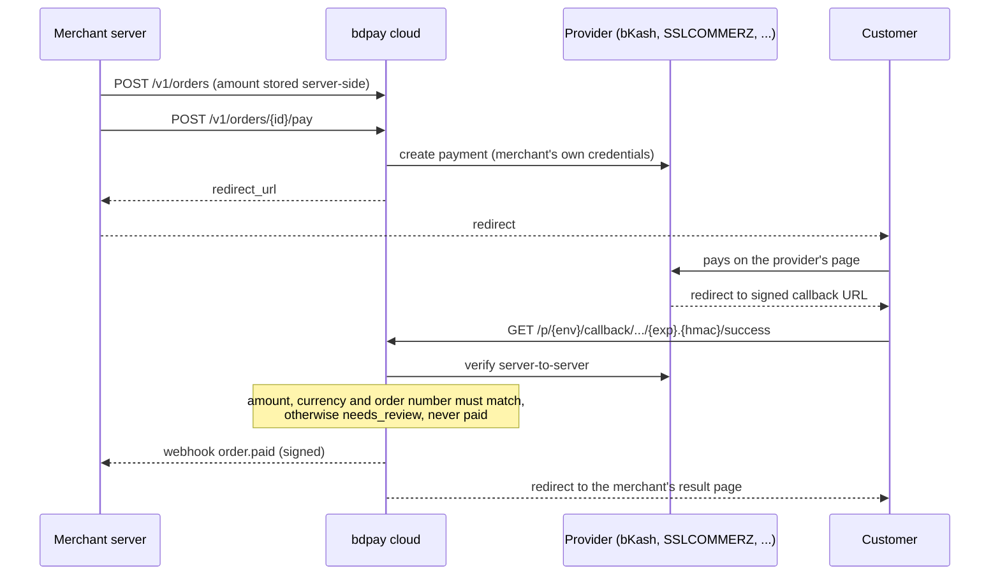

# Bangladesh Payment Gateway Configurator

**bdpay cloud** is an open-source payment gateway configurator and orchestration service for Bangladesh.
Connect bKash, Nagad, SSLCOMMERZ, aamarPay, shurjoPay, EPS, PortPos, PayStation and Upay
(and every card, bank and wallet reached through those aggregators) in one form, then take
payments through one API, a hosted checkout page, or a payment link.

It is multi-tenant: many businesses can share one deployment, each with its own team,
credentials, API keys and payments. It is also **non-custodial**: every business connects
its *own* merchant accounts, and money goes from the customer, through the licensed
provider, straight into that business's account. The service starts and verifies
payments. It never receives, holds or moves funds.

Not affiliated with any payment provider. MIT licensed.

## What is in the box

| | |
|---|---|
| **Configurator** | Pick gateways, paste the credentials each provider issued, test the connection, switch on. Sandbox and live side by side. |
| **One API** | `create order → redirect → verify → paid`, the same for every gateway. Drop-in compatible with self-hosted bdpay. |
| **Hosted checkout and payment links** | A page where the customer picks the method. English and Bangla. No code needed. |
| **Webhooks** | Signed, retried for two days, replayable. Written in the same transaction as the state change, so none is lost or doubled. |
| **Reconciliation** | Payments whose redirect or callback was lost are found by asking the provider again. |
| **Simulator** | A built-in fake provider: take a test payment a minute after signing up, including the awkward cases. |
| **Self-host generator** | Prints a complete, tested Python service for the gateways you tick, in the browser. Nothing you type is sent anywhere. |
| **Teams and audit** | Owner, admin, developer and analyst roles; two-factor sign-in with an authenticator app, which owners can require for live changes; an audit log of who changed what. |
| **Operations** | Health and readiness probes, Prometheus metrics, structured logs with secrets masked, a `doctor` command. |

## Try it in two minutes

You need Docker and git.

```bash
git clone https://github.com/mdzaman/bangladesh-payment-gateway-configurator.git
cd bangladesh-payment-gateway-configurator
docker compose up -d --build
```

Open <http://localhost:8080>, create a workspace, and press **Take a test payment**. The
simulator stands in for a real provider, so the whole flow runs with no credentials:
order, payment page, signed return, server-side verification, refund.

To check a deployment end to end from the command line (after `make setup`, see Develop):

```bash
uv run python scripts/smoke_test.py http://localhost:8080
```

This first run is in development mode. [docs/self-hosting.md](docs/self-hosting.md) covers
production: a domain with HTTPS, the encryption key, SMTP, backups, Kubernetes.

## Three calls from your server

```bash
# 1. Record the order. The amount saved here is the only amount ever accepted.
curl -X POST https://pay.example.com/v1/orders \
  -H "Authorization: Bearer bdp_test_..." -H "Content-Type: application/json" \
  -d '{"order_id":"INV1001","amount":"1250.00","gateway":"bkash","customer":{"phone":"01700000000"}}'

# 2. Get the provider's payment page and send the customer there.
curl -X POST https://pay.example.com/v1/orders/INV1001/pay -H "Authorization: Bearer bdp_test_..."
# -> {"redirect_url":"https://..."}

# 3. Ship after the order.paid webhook arrives (or this says "paid").
curl https://pay.example.com/v1/orders/INV1001 -H "Authorization: Bearer bdp_test_..."
```

Full guide: [docs/api.md](docs/api.md). A running service also serves its OpenAPI
reference at `/docs`.

## How a payment flows



Money moves only between the customer and the provider, into the merchant's account.

## Gateways

| Gateway | Type | Driver | Refund by API |
|---|---|---|---|
| bKash Tokenized Checkout | Mobile wallet | stable | partial |
| Nagad | Mobile wallet | stable (verify against your pack) | merchant panel |
| SSLCOMMERZ | Aggregator: cards, banks, all wallets | stable | partial |
| aamarPay | Aggregator | stable | merchant panel |
| shurjoPay v2.1 | Aggregator | stable | merchant panel |
| EPS | Licensed PSO aggregator | beta | merchant panel |
| PortPos | Aggregator | beta | partial |
| PayStation | Aggregator | beta | merchant panel |
| Upay | Mobile wallet | beta | full only |
| UddoktaPay | Self-hosted wallet automation | experimental, off by default | none |
| Simulator | Built-in test gateway (sandbox only) | stable | partial |

Rocket, OK Wallet, CellFin, Tap, cards and internet banking have no public merchant API;
customers reach them inside an aggregator's checkout. "Beta" means the driver follows
public and community references: compare every field with the provider's onboarding pack
before going live.

## The rules it keeps

The payment engine is the bdpay reference implementation, used unchanged
([core/](core)), so these hold for every gateway:

1. **Server-side amount truth.** A provider answer with a different amount, currency or
   order number puts the order in `needs_review`, never `paid`.
2. **Redirects and IPNs are hints.** Each one triggers a server-to-server verification.
3. **Signed callback links.** HMAC-SHA256, expiring, one secret per workspace environment.
4. **Idempotent, forward-only orders.** Duplicate callbacks and IPNs are harmless.
5. **Cached provider tokens**, refreshed early, fetched by one caller at a time.
6. **Strict HTTP policy.** TLS verification cannot be switched off; live mode refuses `http://`.
7. **Secrets and phone numbers are masked** in logs and in the audit trail.

The hosted service adds what sharing a deployment needs: tenant isolation on every
query, credentials encrypted at rest and never shown again, protection against
server-side request forgery, rate limits, two-factor sign-in, and exactly-once webhook
events. [docs/security.md](docs/security.md) explains each, and says what is not
included: single sign-on, passkeys and database row-level security.

## Repository layout

```
core/     the reference engine: 10 gateway drivers, 35 tests. Byte-for-byte from the build spec.
cloud/    the multi-tenant service (FastAPI, PostgreSQL): API, workers, hosted pages, CLI
web/      dashboard, configurator and self-host generator (React, TypeScript, Vite)
deploy/   Caddy configuration, Kubernetes manifests
docs/     architecture, self-hosting, API, security, compliance, operations, development,
          and the build spec the engine comes from (docs/reference)
scripts/  smoke test and concurrency check for a running deployment
```

## Develop

Needs Python 3.11+, Node 22.12+, Docker and [uv](https://docs.astral.sh/uv/).

```bash
make setup      # Python and Node dependencies
make dev        # PostgreSQL + Redis in Docker, migrations, API and dashboard on :8000
make worker     # in a second terminal: webhooks, reconciliation, email
make test       # engine, service and dashboard test-suites
make lint
```

[docs/development.md](docs/development.md) has the details, including how to add a gateway.

## Tests

| Suite | What it proves |
|---|---|
| `core/tests` (35) | The reference engine, against a fake of every gateway. |
| `cloud/tests` (266) | The service against a real PostgreSQL (14 and 18). Includes the 35 reference tests re-run on the multi-tenant engine, a byte-for-byte check of `core/` against the build spec, tenant isolation object by object, races (one provider session under concurrent starts, one event under concurrent callbacks, one session for one sign-in code, every one of several wrong passwords sent at once counted), SSRF, key rotation, two-factor sign-in. |
| `web` (56) | The generator: twelve generated projects are written to disk and each one's own test-suite is run. The in-browser QR encoder, against values from the standard. |

## Compliance

Under the Payment and Settlement Systems Act 2024, operating a payment system or
providing payment services in Bangladesh needs a Bangladesh Bank licence. This is
merchant-side integration software: it does not hold or pool funds, and it does not
capture card numbers (every flow is a hosted redirect). If you run it as a hosted
service for other businesses, take legal advice first.
[docs/compliance.md](docs/compliance.md) says what the software does and does not do
about this. It is not legal advice.

## Licence

[MIT](LICENSE).
